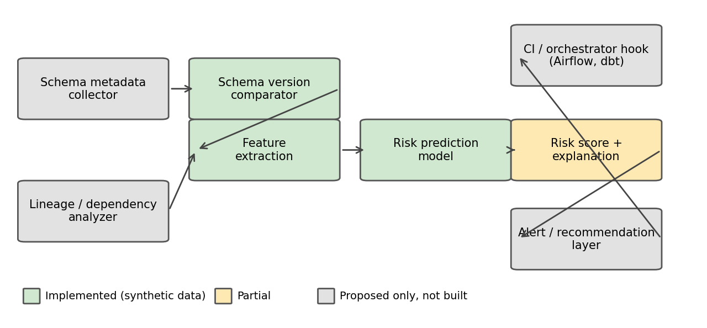
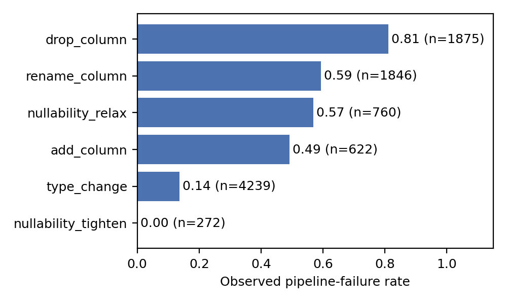
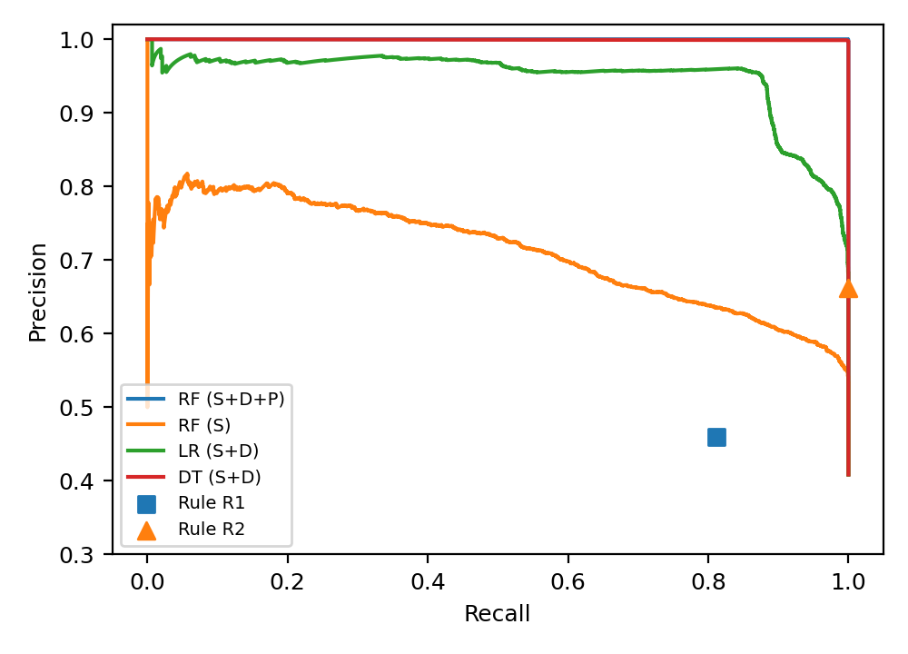
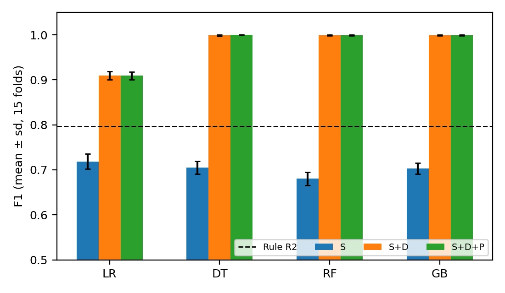
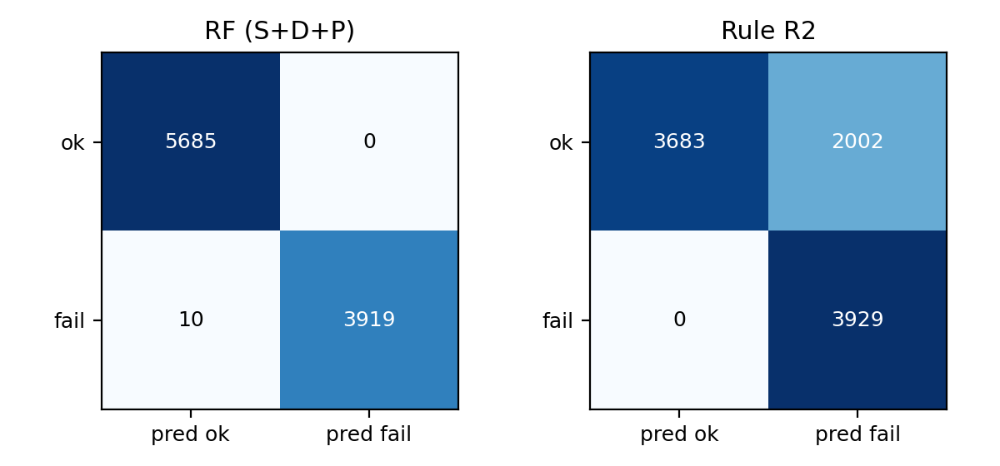
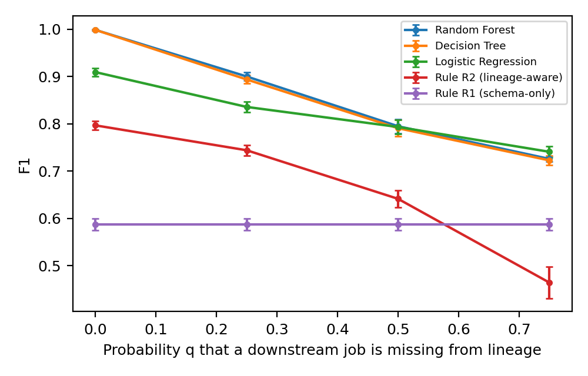

# Towards Predictive Schema Intelligence: Predicting Downstream SQL-Pipeline Failures from Schema Changes on an Execution-Grounded Synthetic Benchmark

*Preprint, not peer reviewed. All experiments use synthetic data. Numbers in this document are inserted automatically from `results/` by `paper/build_manuscript.py`.*

**Author:** Abhay Malhari Davale  
**Affiliation:** Independent Researcher, Kolhapur, Maharashtra, India  
**Corresponding e-mail:** davaleabhay@gmail.com

## Abstract

Changes to upstream database schemas can break downstream data pipelines, and common safeguards such as schema-compatibility rules and data validation either flag changes regardless of whether anything downstream depends on them or react only after data has arrived. This paper asks whether the characteristics of a proposed schema change, together with static lineage information, can predict pipeline failure before the pipeline runs. We build a reproducible, fully synthetic, execution-grounded benchmark: {{N_PIPE}} synthetic pipelines, each with 3–8 downstream SQL jobs, and {{N_CHANGES}} proposed schema changes (column drop, rename, add, type change, nullability relax/tighten). Every change is applied and every job executed in DuckDB {{DUCKDB}}, so failure labels are observed outcomes rather than hand-written rules; {{N_EXEC}} changes were executable and {{N_REJ}} were rejected by the engine at migration time and excluded. Under pipeline-grouped 5-fold cross-validation repeated three times, tree-based models using change features plus static-lineage features reach F1 ≈ {{RF_SDP}} (Random Forest), compared with {{R2_F1}} for an a-priori lineage-aware rule baseline, {{R1_F1}} for a schema-only rule, and {{RF_S}} for a Random Forest restricted to change features. The advantage over the lineage-aware rule is concentrated in type changes, where the rule over-flags. Performance degrades as lineage is hidden (Random Forest F1 {{ROB_RF_50}} when each job is missing from lineage with probability 0.5), and models trained without a change type do not reliably generalize to it. The near-perfect scores show that failures in this benchmark are close to a deterministic function of change, lineage and engine semantics; the results are specific to the synthetic generator and to DuckDB and do not establish performance on real pipelines.

**Keywords:** schema evolution; data pipelines; failure prediction; data quality; impact analysis; synthetic benchmark; reproducibility

## 1. Introduction

Data pipelines depend on the structure of their sources. When an upstream table renames or drops a column, changes a type, or alters nullability, jobs downstream may fail, or may continue and deliver unexpected results. Empirical evidence from mined GitHub projects and Stack Overflow posts attributes about a third of data-related pipeline issues to incorrect data types, and identifies compatibility issues as a distinct problem area [1]. A schema change is not, however, necessarily harmful: adding a nullable column or widening an integer to a larger integer often breaks nothing. A useful early-warning mechanism should therefore separate potentially breaking from harmless changes in the context of the pipeline that consumes them.

This paper studies a deliberately narrow version of the problem: given a proposed schema change and what is known about downstream jobs *before* anything runs, predict whether at least one downstream job will fail. Because no suitable public dataset of schema-change outcomes was found (Section 6), we construct a controlled synthetic benchmark whose labels come from actually executing SQL, and we evaluate simple, interpretable models against rule baselines with a leakage-aware protocol.

**Contributions** (primarily empirical and methodological, and modest in scope): (i) an open, reproducible generator and executor that produces execution-grounded failure labels for schema changes; (ii) a pre-execution feature set and a leakage-controlled evaluation protocol (pipeline-grouped splits, outcome columns excluded, tests); (iii) an empirical comparison of rule baselines and four classifiers, with feature-group ablation, leave-one-change-type-out, class-prevalence and lineage-incompleteness analyses; (iv) an honest account of why high synthetic scores should not be read as real-world evidence.

## 2. Background and Motivation

*Schema evolution and its impact.* Curino et al. analysed the schema history of the MediaWiki database behind Wikipedia using a set of schema modification operators, and proposed the case as the kernel of a schema-evolution benchmark [2]. Qiu et al. mined the histories of ten open-source database applications (over 160K revisions) with a taxonomy of 24 atomic schema-change types, and reported that schemas change frequently, that adding tables, adding columns and changing column datatypes are among the most frequent changes, and that schema changes are accompanied by substantial code modification [3]. Maule et al. proposed static program analysis (program slicing plus context-sensitive dataflow analysis) to estimate how relational schema changes affect object-oriented applications, and evaluated it on 62 versions of a commercial content-management system, reporting no false negatives and a low level of false positives [4]. They also distinguish impacts that cause errors from those that merely change behaviour, a distinction we reflect in our scope.

*Data validation and quality.* Breck et al. describe a schema-based validation system for data fed to ML pipelines, deployed in production in TFX [5]. Schelter et al. present declarative "unit tests for data" executed on Spark, using ML for constraint suggestion and anomaly detection in quality-metric time series; their focus is on the quality of data values rather than on schema changes [6].

*Lineage and impact analysis.* LineageX extracts column-level lineage from SQL queries by static parsing and demonstrates impact analysis of upstream column changes [7]. This suggests that the static-lineage features we simulate could in principle be derived from SQL, which we did not test.

*Failure and defect prediction.* Jassas and Mahmoud compared seven classical classifiers on three public cluster traces (Google, LANL Mustang and Trinity) using a 75%/25% split, and reported decision trees and random forests as best, with F1 up to about 0.99 on the Google trace after feature selection [8]. In software engineering, just-in-time defect prediction uses characteristics of a *change* (for example, size and developer experience) to flag risky changes before problems are found [9], a conceptual precedent for predicting from change characteristics.

## 3. Related Work and Research Gap

*Closest work and difference.* Static impact analysis [4] and schema-based or constraint-based validation [5,6] decide from declared structure whether a change or data batch is acceptable; they do not learn from observed execution outcomes. Co-evolution studies [3,2] characterize what changes and what code co-changes, not whether a downstream execution fails. The pipeline-quality study [1] taxonomizes causes but does not predict. Job-failure and defect prediction [8,9] share the classification setup but use resource or code-change features, not schema-change characteristics. In our own reading of [8] (not a claim by its authors), identifier-like fields such as job ID, task index and machine ID were among the top-ranked features and evaluation used a single random-style split; such features can inflate scores, which is why we exclude identifiers and split by pipeline.

The closest approach we found is a recent preprint on "software world models" [10]. It trains models on labels obtained by *executing* candidate code changes in controlled systems to predict which downstream components a change will break before it is executed, and compares against a dependency-graph (typed-reachability) baseline. Its reported finding that learned prediction helps most where the extracted dependency graph is incomplete parallels our lineage-incompleteness analysis. It differs from this work in setting (multi-repository software systems and services rather than SQL data pipelines), in model family (fine-tuned language models rather than lightweight classical models) and in change taxonomy (code and interface changes rather than column-level schema changes). It is a preprint and has not been peer reviewed to our knowledge.

*Name overlap.* A book chapter indexed as a "predictive approach" to database schema evolution proposes anticipating future requirement changes during schema design so that evolution can be planned and costed, according to its abstract [11]. That is design-time anticipation of change, not prediction of whether a downstream execution will fail.

*Gap (stated cautiously).* Among the sources we examined, we did not find a peer-reviewed study that predicts downstream SQL-pipeline failure from column-level schema-change characteristics and static lineage using execution-derived labels. The execution-labelling idea itself is not new [10]; the contribution here is its transfer to schema changes in SQL pipelines, with an open benchmark and leakage-aware protocol. The search is informal and incomplete: for data contracts and data observability we located mainly industry or grey literature, and academic sources there still need to be searched (see `paper/literature_matrix.md`). Direct queries on column-level lineage and on public schema corpora [7,12] did not reveal a study of this kind either.

## 4. Research Questions and Objectives

**Objective.** Evaluate, on an open execution-grounded synthetic benchmark, whether schema-change characteristics and static lineage can predict downstream SQL-pipeline failure before execution, and document the limits of that claim.

- **RQ1.** Which types of schema change are associated with pipeline failure in this environment? *Analysis:* failure rate by change type and type class (Table 1, Fig. 1).
- **RQ2.** Which schema-change characteristics and pipeline metadata help predict failure? *Experiments:* feature-group ablation S vs. S+D vs. S+D+P (Table 2, Fig. 3) and permutation importance (Table 7).
- **RQ3.** Can ML models identify risky changes better than simple rule baselines? *Experiment:* rules R1/R2 vs. four classifiers on identical grouped folds (Tables 2-4).
- **RQ4.** How could a predictive component integrate with existing data-engineering workflows? *Conceptual only:* a proposed design is described in Section 5; no integration was implemented or tested, so no empirical claim is made.
- **RQ5.** What are the limitations, false-positive risks and data requirements? *Analyses:* leave-one-change-type-out (Table 5), class prevalence (Table 6), incomplete lineage (Table 8), calibration (Table 9), plus Sections 11-12.

No formal hypothesis tests are performed. Scope exclusions: adding NOT NULL columns, key/constraint changes beyond nullability, nested structures, data-value drift, silent semantic changes (outputs that change without an error), real orchestrators and any production logs.

## 5. Proposed Framework and What Is Implemented

*Problem formulation.* Let a pipeline consist of a source schema $S$ and a set of downstream jobs $J$. A proposed change $\delta$ yields a new schema $S' = \delta(S)$. The target is $y(\delta, J) = 1$ if at least one job in $J$ raises an execution error when run on $S'$ (otherwise 0). We learn a function $\hat{y} = f(\phi(\delta, J, \pi(S)))$, where $\phi$ extracts pre-execution features and $\pi(S)$ is a profile of the current data. Failure types are handled as follows: *execution/transformation failure* (exception in a job) is the labelled target; *schema-compatibility failure* is approximated by rule baselines R1/R2; *data-quality violations* and *incorrect output without an error* are not labelled and are excluded. There is no time window: jobs run immediately after the change.

*Prediction time.* A schema change has been proposed but not applied and no downstream job has run. Available inputs: the change description; the declared downstream jobs and which columns each uses (static lineage); and a profile of the current data. Unavailable and never used: job results, error messages, failed-job counts.

*Output.* A failure probability for the (change, pipeline) pair; a threshold of 0.5 gives a binary warning.

| Component | Status in this paper |
|---|---|
| Change representation, pre-execution features, models, grouped evaluation, baselines | **Implemented and evaluated** (synthetic) |
| Execution-grounded benchmark generator and DuckDB executor | **Implemented and evaluated** |
| Integration with schema registries, orchestrators (e.g., Airflow, dbt), CI hooks | Proposed only, not implemented |
| Training on real execution history; online monitoring; deployment | Proposed only, not implemented |

No production system exists; the implementation is an experimental prototype.

*Fig. 0 (conceptual).* Proposed architecture; colours show which parts exist in this study (diagram source: `paper/architecture.mmd`). The risk score is the model's predicted failure probability; no separate formula is proposed. Its calibration is assessed only on synthetic data (Table 9). *Integration (RQ4, proposed).* A realistic hook would run the predictor when a migration is proposed (for example in continuous integration), reading declared lineage from the catalog, and would warn rather than block, because false positives (Tables 3-4) have a different cost from false negatives. Whether this works with real orchestrators is untested.

## 6. Dataset and Experimental Setup

**All data are synthetic.** Each of {{N_PIPE}} pipelines has one source table with {{N_ROWS}} rows and 6–12 columns of types INTEGER, BIGINT, DOUBLE, VARCHAR, DATE, BOOLEAN (with nullability, null rates and numeric-like string columns varied), and 3–8 downstream jobs drawn from nine templates (projection, aggregation, filter, string function, date function, join, NOT-NULL load, positional `SELECT *` load, and a chained job that reads another job's output). Up to 20 candidate changes per pipeline are sampled uniformly from the change space; {{N_CHANGES}} changes were proposed. A fresh schema is built per change, the change is applied via `ALTER TABLE` (type changes use `TRY_CAST`; a nullability relaxation is followed by new rows containing NULLs), and every job is executed in DuckDB [13]. **Label:** failed = 1 if at least one job raises an exception. The six change types correspond to atomic types in the taxonomy of Qiu et al. [3]: add column (A2), drop column (A6), rename column (A7), change column datatype (A8), make column NOT NULL (A21) and drop column NOT NULL (A22). Our sampling frequencies are a design choice and are not claimed to match real-world frequencies. Generator validity is tested: each pipeline must run with zero failures before any change. {{N_REJ}} type changes were rejected by the engine during migration and excluded; {{N_EXEC}} executed examples remain, with an observed failure rate of {{FAIL_RATE}}. This base rate follows from how changes were sampled and is not an estimate of real-world prevalence. We did not find a public dataset combining schema-change history with execution outcomes; the largest public schema corpus we located, SchemaPile (221,171 schemas mined from SQL files on GitHub), describes schema structure and metadata rather than pipeline outcomes, according to its abstract [12]. It could supply realistic schemas for future work.

**Table 1.** Executed examples and observed failure rate by change type.

{{table:dataset}}

*Fig. 1. Observed failure rate by change type (synthetic benchmark).*

## 7. Feature Engineering

Three groups, usable at prediction time: **S** (schema-change; {{FP_CS}} features): change type, old/new type, type-compatibility class (widening, narrowing, to-string, from-string, other), nullability before/after, relative column position, table width. **D** (static lineage; {{FP_SD}} features cumulative): number of jobs, number of jobs using the changed column, count by usage role (select, group, measure, filter, string function, date function, join key, NOT-NULL target), number of positional jobs, transitive jobs affected through chains, maximum chain depth. **P** (pre-change profile; {{FP_SDP}} features cumulative): null rate of the column and the fraction of its non-null values that fail to cast to the proposed type. Outcome columns are excluded by construction and by an assertion and tests.

**Table F.** Candidate features and availability at prediction time (all groups are computable before any job runs).

| Group | Features | How extracted | Why it might help | Limitation |
|---|---|---|---|---|
| S | change type, old/new type, type class, nullability before/after, position, table width | From the change description and current schema | Type class and change kind determine compatibility | Does not know downstream use |
| D | job counts, uses by role, positional jobs, transitive jobs, depth | From declared job metadata (simulated static lineage) | Shows whether and how the column is used | Real lineage is noisier (Table 8) |
| P | null rate, cast-failure rate | SQL profile of current data | Data-dependent casts and NULLs | Small effect here |

Not used (not available or not valid): job outcomes, error messages, failed-job counts, historical failure rate (no real history exists in this study).

## 8. Experimental Methodology

*Baselines (fixed before experiments, never tuned on labels).* **R1** (schema-only, registry-style): breaking if drop, rename, or non-widening type change. **R2** (lineage-aware): R1-style logic applied only where the change touches something downstream (explicit column use or a positional job), plus add-column breaks positional jobs and nullability relaxation breaks NOT-NULL targets or positional jobs. **Always-fail** gives a reference for the base rate.

*Models.* Logistic Regression (standardized), Decision Tree (depth 10), Random Forest (200 trees), HistGradientBoosting; hyper-parameters fixed a priori, no tuning.

*Splits.* Grouped 5-fold cross-validation with the pipeline as the group (no pipeline appears in both train and test), repeated with three seeds (42, 43, 44): 15 held-out evaluations per method. Tables report mean ± standard deviation over these 15 evaluations; because the repetitions reuse the same data these are descriptive and **no significance claims are made**. Metrics: precision, recall, F1 (failure = positive), PR-AUC, ROC-AUC, FPR, FNR, confusion matrices; because the base rate is far from rare in this benchmark, we also examine lower prevalence explicitly. Secondary analyses: leave-one-change-type-out (train on other change types, test pipelines held out by fold); prevalence sensitivity by sub-sampling failures to 20%, 10%, 5%; lineage incompleteness, where each job is hidden from the dependency features with probability q while labels stay unchanged.

## 9. Results

All numbers below come directly from `results/`.

**Table 2.** Main comparison (grouped 5-fold CV × 3 seeds; failure is the positive class).

{{table:main}}

Random Forest with S+D+P reaches F1 {{RF_SDP}}; the lineage-aware rule R2 reaches {{R2_F1}}; the schema-only rule R1 {{R1_F1}}; always predicting failure {{AF_F1}}. Using change features only (S), Random Forest reaches {{RF_S}}, and Decision Tree {{DT_S}}. Adding lineage (S+D) raises Random Forest to {{RF_SD}}, Decision Tree to {{DT_SD}}, and Logistic Regression from {{LR_S}} to {{LR_SD}}. Adding profile features (S+D+P) changes little (Random Forest {{RF_SDP}}; Gradient Boosting {{GB_S}} for S vs. {{GB_SDP}} for S+D+P).

**Table 3.** Pooled out-of-fold confusion counts (seed 42 folds; {{N_POOLED}} examples).

{{table:pooled}}

*Fig. 2. Pooled out-of-fold precision–recall curves; rules shown as single points.*

*Fig. 3. F1 by model and feature set (error bars: sd over 15 evaluations); dashed line is Rule R2.*

R2 produced no false negatives but {{R2_FP}} false positives, all of them type changes ({{R2_FP_TC}}); the Random Forest (S+D+P) produced {{RF_FP}} false positives and {{RF_FN}} false negatives.

**Table 4.** Type-change examples only ({{N_TC}} examples, {{N_TC_FAIL}} failures).

{{table:typechange}}

*Fig. 4. Pooled confusion matrices.*

**Table 5.** Leave-one-change-type-out F1 (training excludes the held-out change type; `nullability_tighten` has no failures, so F1 is 0 by definition).

{{table:locto}}

**Table 6.** Prevalence sensitivity (failures sub-sampled; mean over 10 draws).

{{table:prevalence}}

**Table 7.** Permutation importance of the top Random Forest (S+D+P) features (drop in PR-AUC, mean over held-out folds).

{{table:importance}}

**Table 8.** Robustness to incomplete lineage (q = probability each job is hidden from lineage features; S+D features).

{{table:robust}}

*Fig. 5. F1 versus the fraction of hidden lineage.*

At q = 0.25, 0.5, 0.75 the Random Forest F1 is {{ROB_RF_25}}, {{ROB_RF_50}}, {{ROB_RF_75}}, versus {{ROB_R2_25}}, {{ROB_R2_50}}, {{ROB_R2_75}} for R2 recomputed on the same degraded features.

**Table 9.** Probability calibration (Brier score; lower is better; pooled out-of-fold, seed 42 folds). Calibration is examined only on synthetic data.

{{table:calibration}}

## 10. Discussion

*What the observations support.* (a) Change characteristics alone are only moderately informative here (F1 for S-only models: Random Forest {{RF_S}}, Logistic Regression {{LR_S}}), and static lineage is what makes prediction accurate: knowing which columns downstream jobs use, and how, separates harmful from harmless changes. (b) The a-priori lineage-aware rule R2 already catches every failure but over-flags type changes; the trained models mainly add precision on type changes. A plausible explanation, not tested here, is that the engine's tolerance for a type change depends on the pair of types and on how the column is used (e.g., aggregation versus string function), which R2 does not encode. A rule written with an engine-specific cast table might close this gap; we did not evaluate such a rule. (c) Scores near 1.0 mean the benchmark is close to deterministic given (change, lineage, engine): the models are largely recovering the engine's semantics from examples. This is why the results should not be read as predictive capability in real settings. (d) Performance falls sharply when lineage is incomplete, and leave-one-change-type-out shows models do not reliably extrapolate to change types they have not seen, whereas rule R2, which encodes structure explicitly and is not trained, does not depend on exposure to a change type. A similar pattern, in which learned predictors help most where the extracted dependency graph is incomplete, has been reported for software systems [10]; that study is a non-peer-reviewed preprint in a different setting, so we treat it as consistent with, not confirmation of, our finding. (e) Prevalence sub-sampling shows precision of the change-only model and of the rules drops as failures become rarer, as expected for a fixed false-positive rate.

*Practical implications (proposed, untested in production).* If lineage metadata is available and reasonably complete, a pre-merge check that scores a schema migration could help prioritise review; lineage completeness is the main practical dependency (Table 8). A warning-only mode limits the cost of false positives. These statements are hypotheses, not findings.

*Untested hypotheses and future work.* Whether the same feature groups matter on real pipelines; whether results hold on other engines (Spark SQL, Postgres, BigQuery); behavior when failures are silent; learning from real execution history; comparison against an engine-aware rule engine; cost-sensitive thresholds.

## 11. Threats to Validity

*Construct:* failure is defined as an exception; silent data corruption is not measured. *Internal:* hyper-parameters were fixed, not tuned; baseline R2 was written before experiments but by the author with knowledge of the generator, which may favor it on structural change types. *External:* synthetic pipelines, one SQL engine (DuckDB {{DUCKDB}}), small tables, job templates chosen by the author, and a base rate set by the sampling design. *Statistical:* repeated CV on one dataset; spread estimates are descriptive and not independent. *Circularity:* labels are execution-based, but job templates and feature definitions share a vocabulary (roles), so lineage features describe exactly how jobs use columns; real lineage metadata is noisier.

## 12. Limitations

The study is a proof of concept on a synthetic benchmark. It does not include real production data, concurrent or streaming settings, multi-table schemas, or data-value drift. {{N_REJ}} type changes were excluded because the engine rejected them at migration; this removes cases where the database itself prevents the change. The literature review is incomplete.

## 13. Ethical and Reproducibility Considerations

No personal or proprietary data are used. All code, seeds, configuration and a dataset fingerprint are provided; `python src/run_all.py` regenerates all tables, figures and this manuscript; 8 automated tests cover generator determinism, generator validity, leakage guards, grouped splitting and rule semantics. Software: Python 3.12, DuckDB [13] {{DUCKDB}}, scikit-learn [14], pandas, NumPy, Matplotlib (versions in `results/run_config.json` and `requirements.txt`). An MIT licence file is included; archiving the repository (for example on Zenodo) would provide a citable DOI.

**Data availability.** All data are synthetic and regenerated by `src/build_dataset.py` (seed 42; fingerprint in `data/dataset_meta.json`). No third-party data were used. **Code availability.** Code, tests and manuscript build scripts are in the project repository (https://github.com/8abhay/predictive-schema-intelligence; MIT licence). **Funding.** None declared by the author. **Conflict of interest.** None declared by the author. **Author contributions.** Abhay Malhari Davale is the sole author. **AI-assistance disclosure.** An AI assistant (Claude, Anthropic) helped with literature search, code, experiment execution and drafting; the author must review every claim, verify every reference and take responsibility for the final text; follow the target venue's AI-use policy. **Acknowledgements.** None.

## 14. Conclusion and Future Work

On an execution-grounded synthetic benchmark, combining schema-change features with static lineage yields near-perfect failure prediction, clearly better than a schema-only rule and than change features alone, and more precise than an a-priori lineage-aware rule; but the result reflects the near-determinism of the benchmark, degrades with incomplete lineage and does not extend to unseen change types. The principal value of the work is a reproducible, leakage-aware evaluation scaffold and an honest baseline for future studies on real pipeline histories.

## References

Reference metadata were checked against publisher, arXiv or index pages; the status of each reference is recorded in `paper/citation_audit.md`.

[1] H. Foidl, V. Golendukhina, R. Ramler, and M. Felderer, "Data pipeline quality: Influencing factors, root causes of data-related issues, and processing problem areas for developers," *J. Syst. Softw.*, vol. 207, art. no. 111855, 2024, doi:10.1016/j.jss.2023.111855 (preprint: arXiv:2309.07067).

[2] C. A. Curino, H. J. Moon, L. Tanca, and C. Zaniolo, "Schema evolution in Wikipedia: Toward a web information system benchmark," in *Proc. 10th Int. Conf. Enterprise Information Systems (ICEIS)*, vol. 1, 2008, pp. 323–332, doi:10.5220/0001713003230332.

[3] D. Qiu, B. Li, and Z. Su, "An empirical analysis of the co-evolution of schema and code in database applications," in *Proc. 9th Joint Meeting on Foundations of Software Engineering (ESEC/FSE '13)*, Saint Petersburg, Russia, 2013, pp. 125-135, doi:10.1145/2491411.2491431.

[4] A. Maule, W. Emmerich, and D. S. Rosenblum, "Impact analysis of database schema changes," in *Proc. Int. Conf. Software Engineering (ICSE)*, 2008, pp. 451–460, doi:10.1145/1368088.1368150.

[5] E. Breck, N. Polyzotis, S. Roy, S. E. Whang, and M. Zinkevich, "Data validation for machine learning," in *Proc. SysML*, 2019.

[6] S. Schelter, D. Lange, P. Schmidt, M. Celikel, F. Biessmann, and A. Grafberger, "Automating large-scale data quality verification," *Proc. VLDB Endow.*, vol. 11, no. 12, pp. 1781–1794, 2018, doi:10.14778/3229863.3229867.

[7] S. H. Zhang, Z. Miao, and J. Wang, "LineageX: A column lineage extraction system for SQL," arXiv:2505.23133, 2025 (demo track, 41st IEEE Int. Conf. Data Engineering, ICDE 2025, per the arXiv comments).

[8] M. S. Jassas and Q. H. Mahmoud, "Analysis of job failure and prediction model for cloud computing using machine learning," *Sensors*, vol. 22, no. 5, art. 2035, 2022, doi:10.3390/s22052035.

[9] Y. Kamei, E. Shihab, B. Adams, A. E. Hassan, A. Mockus, A. Sinha, and N. Ubayashi, "A large-scale empirical study of just-in-time quality assurance," *IEEE Trans. Softw. Eng.*, vol. 39, no. 6, pp. 757–773, Jun. 2013, doi:10.1109/TSE.2012.70.

[10] T. Su, Y. Hu, L. Zhao, B. Zhu, J. Somasundaram, and H. Haque, "Software world models: From consequence prediction to decision value," arXiv:2610.04940, 2026 (preprint, not peer reviewed to our knowledge).

[11] H. Bounif, "Predicitive [sic] approach for database schema evolution," in *Intelligent Databases*, IGI Global, 2007, pp. 286-309, doi:10.4018/978-1-59904-120-9.ch011 (title as indexed by Crossref; abstract-level reading only).

[12] T. Döhmen, R. Geacu, M. Hulsebos, and S. Schelter, "SchemaPile: A large collection of relational database schemas," *Proc. ACM Manag. Data*, vol. 2, no. 3 (SIGMOD), art. 172, Jun. 2024, doi:10.1145/3654975.

[13] M. Raasveldt and H. Mühleisen, "DuckDB: An embeddable analytical database," in *Proc. 2019 Int. Conf. Management of Data (SIGMOD '19)*, 2019, pp. 1981-1984, doi:10.1145/3299869.3320212.

[14] F. Pedregosa *et al.*, "Scikit-learn: Machine learning in Python," *J. Mach. Learn. Res.*, vol. 12, pp. 2825–2830, 2011 (metadata taken from the reference list of [6]).
